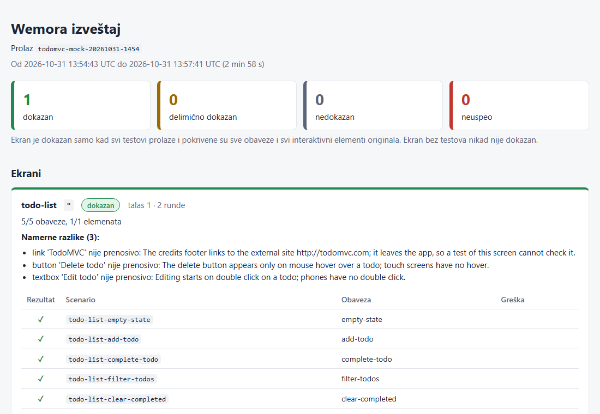
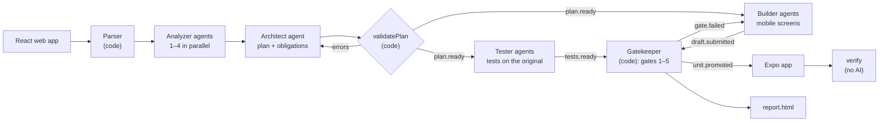
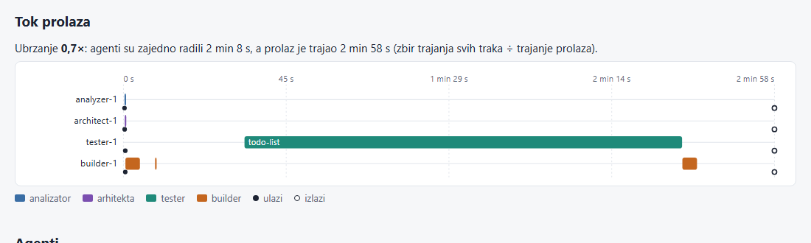

# Wemora

**Web → mobile migration that proves it works.** Wemora takes a React web app (an SPA with React Router) and builds an Expo (React Native) app, screen by screen. For every screen it **proves with executable tests** that the mobile version behaves like the original, and says so in a report.



*The report of a committed run, [`runs/todomvc-mock-20261031-1454`](runs/todomvc-mock-20261031-1454/report.html): the TodoMVC screen is **proven**: all 5 obligations are covered by tests that passed on the original web app and on the new mobile app. The report itself is in Serbian, the language of the team.*

Built for the JigJoy × NTP Novi Sad Hackathon (Freestyle category) on the [Mozaik](https://www.npmjs.com/package/@mozaik-ai/core) multi-agent framework.

<!--
TODO(D19), what is still missing in this README (also in docs/status/d.md):
1. A Recepti run in runs/ (runs/recepti-<time>): needs a real run (A, API key) or tester/builder mock
   replies for Recepti (B, C). Then: screenshot of its report here, and use it in "Quick start".
2. `npm run verify` and `npm run sabotage` in the CLI (A18; both functions are merged, the CLI still
   prints "not implemented yet"). Then: replace the `npx tsx -e …` commands in "Quick start" with
   `npm run verify -- <run>` and `npm run sabotage -- <run> <unitId>` and paste their output.
3. A real-model run (`npm run migrate`, not --mock) archived in runs/, with its cost and speed-up
   from the report, quoted in "How Wemora uses Mozaik".
4. A license: the team has not chosen one (there is no LICENSE file; package.json says ISC, the npm default).
5. Last pass: follow this README on a clean clone (someone who did not write it), and paste every
   command and its output from the terminal.
-->

## The problem and how Wemora solves it

A team has a web app, and the client wants a mobile app. Today they pick one of two:

- **A wrapper** (Capacitor, a PWA): fast, but it is the website in a frame, not a native app, and desktop layouts (sidebars, wide tables, hover) stay broken on a phone.
- **An AI code generator:** it writes plausible React Native code, but nobody knows whether each screen still does what the original did. Someone has to click through everything by hand, every time.

Wemora's product is **the proof, not the code**:

- **Tests come from the original.** Tester agents write UI tests against the *running* web app. A test is kept only if it passes on the original, fails on an empty screen, and each check fails when run before its action, so it really tests something.
- **The code under test cannot touch its tests.** Builder agents write mobile screens and never read or write tests. They can only write inside their own staging folder; a Mozaik interception rejects anything else before it happens.
- **Plain code gives the verdict, not AI.** The Gatekeeper runs type checks, label checks and the tests on the Expo web build, and only then copies a screen into the app. Every screen ends as *proven*, *partially proven*, *unproven* or *failed*, with the reason.
- **Anyone can check it later, with no AI and no API key:** `verify` runs all the tests of a committed run again.
- **Desktop-only UI is handled openly.** When something cannot look the same on a phone (a filter row moves behind a button, a hover tooltip has no touch equivalent), the plan records it as an *intentional difference*, and the report lists it in plain words, instead of hiding it.

## How it works



1. **Analysis.** A parser (TypeScript compiler API, no AI) finds routes, files and web-only APIs. 1–4 analyzer agents read their part of the app and describe each screen: what it shows, what the user can do, what will not fit a phone. An architect agent turns that into a plan: units of work, the **obligations** each screen must keep (with the exact texts from the original), and intentional differences. Plain code checks the plan and sends the errors back to the architect.
2. **Building and testing at the same time.** Testers write tests for every screen while builders rewrite screens in waves (shared code first). Each builder round starts from a fresh context with the last error.
3. **Gatekeeper.** For each draft: parse → no web-only APIs (`div`, `window`, `localStorage`…) → `tsc` → labels from the original are still there → all tests of the screen pass on the Expo web build. A promoted screen is followed by a regression run of every screen already in the app; if one breaks, the change is rolled back.
4. **Report and proof.** Every screen gets a status:

| Status | When |
|---|---|
| **proven** | all tests pass, every obligation is covered, and every interactive element of the original is used by a test or marked not portable |
| **partially proven** | all its tests pass, but coverage is not complete (the report lists what has no test) |
| **unproven** | no validated tests; **a screen with zero tests is never proven** |
| **failed** | tests exist and the screen still fails them after the last round |

**Looks vs. proof.** The layout may change on a phone (columns, a table becomes cards, a sidebar becomes tabs), but fonts, sizes and colors are carried over from the web: the architect puts the app's global stylesheets into a shared `theme` unit, built first, and every screen uses it. The proof is about behavior: *proven* means the screen does what the original does, not that it looks the same.

The report (Serbian) also shows a timeline of all agents, the speed-up from running them in parallel, the agent count over time, the cost per agent, and the rounds and models per unit. Full architecture (Serbian): [`docs/architecture.md`](docs/architecture.md).



## How Wemora uses Mozaik

Wemora is built on [`@mozaik-ai/core`](https://www.npmjs.com/package/@mozaik-ai/core) 4.1.0. The agents are Mozaik participants on one shared runtime; the deterministic parts (Conductor, Gatekeeper) are participants too, so everything talks through the same events.

- **Many agents in parallel.** Analyzers, testers and builders are separate Mozaik agents, each with one active loop and a fresh `ModelContext` per task ([`agents/_shared/context.ts`](src/agents/_shared/context.ts), [`agents/_shared/run.ts`](src/agents/_shared/run.ts)). Testers and builders work at the same time on different screens, so the work of many agents fits into one run window; the report measures this as the speed-up.
- **Agent count changes during the run.** The Conductor computes how many agents are needed (analyzers from the code size, builders from the ready units, testers from the builders) and adds or removes them with Mozaik's `join` / `leave`, at most once a minute, never stopping a busy agent ([`orchestration/scaling.ts`](src/orchestration/scaling.ts), [`orchestration/conductor.ts`](src/orchestration/conductor.ts)). Every change and its reason go to the log and to the report.
- **A shared board.** `MigrationState` extends Mozaik's `RuntimeState` and holds the parsed app, analyzer reports, plan, tests, results and costs ([`core/state.ts`](src/core/state.ts)). The one runtime is defined once ([`core/runtime.ts`](src/core/runtime.ts)).
- **Events carry only IDs.** `analysis.done { partId }`, `tests.ready { unitId }`, `draft.submitted { unitId, round }`… ([`contracts/events.ts`](src/contracts/events.ts)); the data stays on the board and on disk. The Conductor and the Gatekeeper are deterministic participants (`createHuman`) that react to these events ([`agents/gatekeeperParticipant.ts`](src/agents/gatekeeperParticipant.ts)).
- **Interception enforces file ownership.** `OwnershipGuard` checks every `write_file` call of a builder before it runs and rejects any path outside the builder's own staging folder; `CancelGuard` ends a loop on a timeout ([`agents/_shared/guards.ts`](src/agents/_shared/guards.ts)).
- **Structured output, checked twice.** Analyzer and architect answer with JSON schemas from zod (cleaned for the Anthropic strict mode, [`agents/_shared/schema.ts`](src/agents/_shared/schema.ts)); every answer is checked with zod again and errors go back to the model.
- **Our own inference runner.** `BudgetedRunner` retries rate limits and network errors, never throws (a throw inside Mozaik's `runLoop` would end the process), counts tokens and cost per agent and stops at the budget. `MockRunner` replays scripted answers, so the whole flow runs for $0 ([`core/runner.ts`](src/core/runner.ts)).
- **Every event is logged.** A participant writes all runtime events (except token streams) to `run.jsonl` ([`orchestration/eventLogger.ts`](src/orchestration/eventLogger.ts)); the report's timeline, cost and agent sections are computed from it.

| Agent | Default model | Tools | Prompt |
|---|---|---|---|
| Analyzer | claude-haiku-4-5 | `list_files`, `read_file` (its part only, read-only) | [`analyzer.md`](src/agents/prompts/analyzer.md) |
| Architect | claude-sonnet-4-6 | none (structured output) | [`architect.md`](src/agents/prompts/architect.md) |
| Tester | claude-haiku-4-5 | `aria_snapshot`, `try_scenario`, `save_scenario` | [`tester.md`](src/agents/prompts/tester.md) |
| Builder | claude-haiku-4-5 for rounds 1–2, claude-sonnet-4-6 for rounds 3–4; after round 4 the unit fails | `read_source`, `read_app`, `write_file`, `check_draft`, `submit_draft` | [`builder.md`](src/agents/prompts/builder.md) |

The models are defaults: `WEMORA_MODEL_DEFAULT` and `WEMORA_MODEL_STRONG` in `.env` replace them (for example with the models a gateway serves).

## Quick start (no API key)

Requirements: **Node 22.12+** and npm. On Windows, use Git Bash or PowerShell.

```bash
git clone https://github.com/milicaantic/wemora.git
cd wemora
npm ci
npx playwright install chromium            # browser for the UI tests
cd templates/expo && npm ci && cd ../..    # Expo, used to export apps for the web
npm run build                              # type check + layer rules
npm test                                   # unit tests, no network, no API key
```

### Check a committed run again

[`runs/`](runs/) holds finished runs; [`runs/README.md`](runs/README.md) says what each folder holds. `verify` re-runs every test of a run on a web export of its app, with no AI and no API key.

> The commands `npm run verify -- <run>` and `npm run sabotage -- <run> <unitId>` are being wired into the CLI and still print "not implemented yet". Until then, the commands below call the same functions directly; they work in Git Bash and PowerShell.

```bash
npx tsx -e "import('./src/verify/index.ts').then(async (m) => { const d = await m.verifyDetailed('runs/todomvc-mock-20261031-1454'); console.log(m.formatVerifyReport(d)); process.exit(d.ok ? 0 : 1) })"
```

```
verify /path/to/wemora/runs/todomvc-mock-20261031-1454

todo-list  [proven]
  pass  todo-list-empty-state
  pass  todo-list-add-todo
  pass  todo-list-complete-todo
  pass  todo-list-filter-todos
  pass  todo-list-clear-completed

OK: 5/5 tests pass on 1 screen(s) whose tests passed in the run
```

Then open [`runs/todomvc-mock-20261031-1454/report.html`](runs/todomvc-mock-20261031-1454/report.html) in a browser.

- **Output:** a screen × test matrix (`pass` / `FAIL`) and a last line `OK: …` or `FAILED: …`; exit code 0 for `OK`, 1 for `FAILED`. Only screens that were `proven` or `partial` in the run count; `failed` and `unproven` screens are listed but do not fail `verify`.
- A committed run has no `node_modules`; `verify` links `templates/expo/node_modules`. Without the `npm ci` in `templates/expo` above it stops with `templates/expo/node_modules not found: run "npm ci" in templates/expo once`.
- **Recepti runs only:** start the mock API first (`cd examples/mock-api && npm start`), because the app reads its data from it. TodoMVC needs nothing else.
- The first export after a fresh clone takes about a minute (cold Metro cache); later ones take 7–13 s.

### Break a screen on purpose: `verify` must catch it

`sabotage` changes one promoted screen of a run (it replaces a label or text the tests look for with `[sabotaged]`), so `verify` must then fail on that screen. It edits the run folder in place, so work on a copy in `output/` (ignored by git):

```bash
node -e "require('fs').cpSync('runs/todomvc-mock-20261031-1454', 'output/sabotage-demo', { recursive: true })"
npx tsx -e "import('./src/verify/index.ts').then(async (m) => console.log(await m.sabotageDetailed('output/sabotage-demo', 'todo-list')))"
npx tsx -e "import('./src/verify/index.ts').then(async (m) => { const d = await m.verifyDetailed('output/sabotage-demo'); console.log(m.formatVerifyReport(d)); process.exit(d.ok ? 0 : 1) })"
```

`sabotage` reports what it changed (`target: 'New Todo Input', kind: 'label'` in `app/src/screens/todo-list/index.tsx`), and `verify` fails with exit code 1:

```
verify /path/to/wemora/output/sabotage-demo

todo-list  [proven]
  pass  todo-list-empty-state
  FAIL  todo-list-add-todo at step 2: submit field labelled "New Todo Input": not found on screen within 5000 ms
  FAIL  todo-list-complete-todo at step 2: submit field labelled "New Todo Input": not found on screen within 5000 ms
  FAIL  todo-list-filter-todos at step 2: submit field labelled "New Todo Input": not found on screen within 5000 ms
  FAIL  todo-list-clear-completed at step 2: submit field labelled "New Todo Input": not found on screen within 5000 ms

FAILED: 1/5 tests pass on 1 screen(s) whose tests passed in the run
```

<!-- TODO(D19): when A18 lands, use `npm run verify -- runs/<run>` and `npm run sabotage -- <copy> <unitId>` here
and paste their output; switch the example to runs/recepti-<time> once it exists. -->

## Run a full migration

### The example apps

Wemora ships two input apps in [`examples/`](examples/):

| App | What it is | Run the original |
|---|---|---|
| [Recepti](examples/recepti/) | 5 screens, built **for desktop only** on purpose (sidebar, wide table, side-by-side views, hover) | mock API + `npm run dev`, see below |
| [TodoMVC](examples/todomvc/) | the React TodoMVC from [tastejs/todomvc](https://github.com/tastejs/todomvc), unchanged, so Wemora is not tuned to our own example | `cd examples/todomvc && npm ci && npm run build && npm run serve` → http://localhost:7002 |

The tester agent opens the **running** original in a browser, so start it before a run and pass its address with `--original-url`.

### For $0, with scripted model answers (`--mock`)

`--mock` replaces only the model: the agents get recorded answers from [`src/agents/mocks/`](src/agents/mocks/), and everything else is real (Expo export, gates, tests on both apps, regression, report).

```bash
# terminal 1: the original
cd examples/todomvc && npm ci && npm run build && npm run serve

# terminal 2
npm run migrate:mock -- examples/todomvc --original-url http://localhost:7002
```

It ends with a summary (outcome `finished`, `todo-list: promoted`) and the path of `output/<run-id>/report.html`. It takes about 3 minutes, most of it the first Expo export.

<!-- TODO(D19): Recepti with --mock needs tester and builder mock replies for Recepti (B, C);
only analyzer and architect replies exist in src/agents/mocks/recepti/. -->

### With a real model

Copy `.env.example` to `.env` and set `ANTHROPIC_API_KEY`. For the hackathon gateway, also set `ANTHROPIC_BASE_URL` (see the comments in [`.env.example`](.env.example)); the default models are the ones it serves, so nothing else is needed. Never commit `.env`, and do not add `MOZAIK_API_KEY` (it turns on Mozaik Cloud telemetry).

```bash
# terminal 1: mock API (Recepti reads its data from it)
cd examples/mock-api && npm start                    # http://localhost:3000

# terminal 2: the original
cd examples/recepti && npm ci && npm run dev         # http://localhost:5173

# terminal 3
npm run migrate -- examples/recepti --original-url http://localhost:5173
```

`--budget` (default 5) is a hard limit in USD: when the run reaches it, no new work starts, units still waiting end as failed, and the report still gets built. Other options: `--max-builders` (default 4), `--max-testers` (default 2), `--out` (default `output`).

<!-- TODO(D19): paste the summary of a real Recepti run here (outcome, statuses, cost, duration),
and archive it: npx tsx -e "import('./src/report/index.ts').then(async (m) => console.log(await m.archiveRun('output/<run-id>', 'runs', 'recepti-<yyyymmdd-hhmm>')))"
(or `npm run archive` if A adds it, see docs/inbox). -->

## Output of a run

```
output/<run-id>/
  plan.json              migration plan: units, obligations, intentional differences, route map
  analysis/              one report per part of the app, from the analyzers
  tests/<screen>.json    validated tests; only testers write here
  staging/<builder>/     drafts; builders write only here
  app/                   the Expo app; only the Gatekeeper (and scaffold) write here
  results/<screen>.json  gate results, status and coverage
  run.jsonl              every event, with time and cost
  report.html            the report
```

To keep a run, copy it into `runs/` without dependencies and drafts (see [`runs/README.md`](runs/README.md#add-a-run)).

## Limitations and out of scope

- **Input:** React 18/19 single-page apps with React Router 6/7 routes, plain CSS or CSS modules, hooks and Context, `fetch` and `localStorage`. Apps outside this profile are refused with a clear error (for example Next.js, or React Router 5).
- **Out of scope:** Next.js / SSR / RSC, Tailwind and shadcn, CSS-in-JS, auth and cookies, native APIs (camera, push), iOS, store publishing, pixel comparison, web-only libraries (maps, charts).
- **Tests run on the Expo web build** (390×844) with Playwright, not on a phone or emulator. An Android export check is planned as an optional extra gate and is not in the gates yet.
- Tests use names (labels, button and link texts). Elements with no name, and gestures with no web equivalent (hover, double click, long press), are recorded as intentional differences instead of tested.
- A `--mock` run proves that the pipeline works; it does not show what a model writes. Runs from a real model are added to `runs/` with names without `mock`.

## Team

Built by a team of four for the JigJoy × NTP Novi Sad Hackathon (Freestyle category). Each person owns one part of the code:

| | Owns | Folders |
|---|---|---|
| **JavorFaks** | contracts, runtime and board, inference runner, Conductor and agent scaling, CLI | [`src/contracts/`](src/contracts/), [`src/core/`](src/core/), [`src/orchestration/`](src/orchestration/), [`src/agents/_shared/`](src/agents/_shared/), [`src/cli.ts`](src/cli.ts) |
| **Vujic04** | test DSL and runners, tester agent, `verify` and `sabotage` | [`src/scenarios/`](src/scenarios/), [`src/verify/`](src/verify/), [`src/agents/tester.ts`](src/agents/tester.ts) |
| **Milica Antić** | Expo template, scaffold, Gatekeeper and its gates, builder agent | [`src/gatekeeper/`](src/gatekeeper/), [`src/scaffold/`](src/scaffold/), [`templates/expo/`](templates/expo/), [`src/agents/builder.ts`](src/agents/builder.ts) |
| **Kuzma04** | parser and plan checks, analyzer and architect agents, report, example apps, `runs/`, this README | [`src/analysis/`](src/analysis/), [`src/report/`](src/report/), [`examples/`](examples/), [`src/agents/analyzer.ts`](src/agents/analyzer.ts), [`src/agents/architect.ts`](src/agents/architect.ts) |

The plan, the decisions and the messages between us are in [`docs/`](docs/) (in Serbian): [`architecture.md`](docs/architecture.md), [`decisions.md`](docs/decisions.md), [`tim-plan.md`](docs/tim-plan.md), [`inbox/`](docs/inbox/).

<!-- TODO(D19): full names if the team wants them instead of GitHub handles; a license (no LICENSE file yet, package.json says ISC, the npm default). -->
