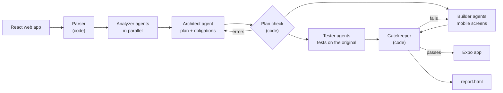

# Wemora

**Turn a React web app into an Expo mobile app, and prove every screen still works.**


Wemora reads a React single-page app, plans the migration, and lets a team of AI agents rewrite it for Expo (React Native) screen by screen. Other agents write UI tests against the **running original**, and plain code (not AI) decides whether each mobile screen passes them. The result is a mobile app plus a report that says, for every screen, whether its behavior is **proven**.


<sub>The report of the run in [`runs/todomvc-mock-20261031-1454`](runs/todomvc-mock-20261031-1454/report.html). The report is in Serbian, the team's language.</sub>

Built for the **JigJoy × NTP Novi Sad Hackathon** (Freestyle) on the [Mozaik](https://www.npmjs.com/package/@mozaik-ai/core) multi-agent framework.

---

## Why

A team has a web app and a client who wants a mobile app. Today the choice is:

- **a wrapper** (Capacitor, PWA): fast, but it is the website in a frame, and desktop layouts stay broken on a phone;
- **an AI code generator**: it writes plausible code, but nobody knows if each screen still does what it did, so someone clicks through everything by hand.

Wemora's product is **the proof, not the code**:

- **Tests come from the original.** A test is kept only if it passes on the running web app, fails on an empty screen, and each check fails when run before its action.
- **The code under test never sees its tests.** Builder agents cannot read or write tests and can only write in their own folder; a Mozaik interception blocks anything else before it happens.
- **Code gives the verdict, not AI.** Type checks, label checks and the tests run on the mobile app's web build; only a screen that passes them goes into the app.
- **Anyone can check it again, with no AI and no API key** (`npm run verify`).

---

## Try it (about 10 minutes, no API key)

You need **Node 22 or newer** and **npm**. The commands work in Git Bash and PowerShell on Windows, and in any shell on macOS and Linux.

### 1. Install

```bash
git clone https://github.com/milicaantic/wemora.git
cd wemora
npm ci
npx playwright install chromium
cd templates/expo && npm ci && cd ../..
```

The last line installs Expo, which Wemora uses to build the mobile app for the web.

### 2. Check a finished migration

[`runs/`](runs/) holds a finished migration of the [TodoMVC](https://github.com/tastejs/todomvc) app. `verify` builds its mobile app and runs every test again:

```bash
npm run verify -- runs/todomvc-mock-20261031-1454
```

```
todo-list  [proven]
  pass  todo-list-empty-state
  pass  todo-list-add-todo
  pass  todo-list-complete-todo
  pass  todo-list-filter-todos
  pass  todo-list-clear-completed

OK: 5/5 tests pass on 1 screen(s) whose tests passed in the run
```

Open [`runs/todomvc-mock-20261031-1454/report.html`](runs/todomvc-mock-20261031-1454/report.html) in a browser to see the full report. The first `verify` takes about a minute (Expo's first build); later ones take seconds.

### 3. Break a screen and watch `verify` catch it

`sabotage` changes the mobile screen on purpose (it renames a field the tests look for):

```bash
npm run sabotage -- runs/todomvc-mock-20261031-1454 todo-list
npm run verify -- runs/todomvc-mock-20261031-1454
```

```
todo-list  [proven]
  pass  todo-list-empty-state
  FAIL  todo-list-add-todo at step 2: submit field labelled "New Todo Input": not found on screen within 5000 ms
  FAIL  todo-list-complete-todo at step 2: submit field labelled "New Todo Input": not found on screen within 5000 ms
  FAIL  todo-list-filter-todos at step 2: submit field labelled "New Todo Input": not found on screen within 5000 ms
  FAIL  todo-list-clear-completed at step 2: submit field labelled "New Todo Input": not found on screen within 5000 ms

FAILED: 1/5 tests pass on 1 screen(s) whose tests passed in the run
```

`verify` exits with code 1. Undo the change with:

```bash
git checkout -- runs/
```

### 4. Run a whole migration

This runs the full pipeline on TodoMVC: analysis, plan, building and testing in parallel, the gates, and the report. `--mock` replaces only the AI model with recorded answers, so it costs nothing; the mobile app, the gates and the tests are real.

```bash
cd examples/todomvc && npm ci && cd ../..
npm run migrate:mock -- examples/todomvc
```

It takes about 3 minutes and ends with a summary:

```
outcome: finished
  app-entry: promoted
  theme: promoted
  todo-list: promoted
report:  …/output/<run-id>/report.html
```

---

## Run it with a real model

1. Copy `.env.example` to `.env` and set `ANTHROPIC_API_KEY`. For the hackathon gateway, also set `ANTHROPIC_BASE_URL` (see the comments in [`.env.example`](.env.example)).
2. Install and start the example's data server, then run Wemora:

```bash
cd examples/recepti && npm ci && cd ../..
cd examples/mock-api && npm start          # keep this running (http://localhost:3000)
```

```bash
npm run migrate -- examples/recepti        # in a second terminal
```

Wemora builds and serves the original app by itself, runs the agents, and writes everything to `output/<run-id>/`. `--budget` (default **$5**) is a hard limit: when it is reached, no new work starts and the report is still written. Keep a finished run with `npm run archive -- output/<run-id>`, which copies it into `runs/` without dependencies.

The two example apps:

| App | What it tests |
|---|---|
| [**Recepti**](examples/recepti/) | 5 screens built for desktop only on purpose: sidebar, wide table, side-by-side views, hover details |
| [**TodoMVC**](examples/todomvc/) | the React TodoMVC from [tastejs/todomvc](https://github.com/tastejs/todomvc), unchanged, so Wemora is not tuned to our own example |

---

## How it works



1. **Analyze.** A parser finds the routes, files and web-only APIs. Analyzer agents describe each screen: what it shows, what the user can do, what will not fit a phone. An architect agent turns this into a plan: units of work, the **obligations** each screen must keep (with the exact texts of the original), and the **intentional differences** (for example, filters that move behind a button on a phone). Code checks the plan and sends errors back to the architect.
2. **Build and test at the same time.** Tester agents write tests for every screen while builder agents rewrite screens, shared code first. A builder gets up to four rounds per screen, each with the last error; rounds 3 and 4 use a stronger model.
3. **Gatekeeper.** For each draft: it parses, has no web-only APIs (`div`, `window`, `localStorage`…), passes `tsc`, keeps the labels of the original, and passes all tests of the screen on the mobile web build. After each new screen, the tests of all earlier screens run again; if one breaks, the change is undone.
4. **Report.** Every screen ends with a status:

| Status | Meaning |
|---|---|
| **proven** | all tests pass, every obligation is tested, and every button, link and field of the original is tested or marked as not portable |
| **partially proven** | all its tests pass, but some obligations or elements have no test (the report lists them) |
| **unproven** | no validated tests; a screen with zero tests is never proven |
| **failed** | the screen still fails its tests after the last round |

**Looks vs. proof.** The layout may change on a phone (a table becomes cards, a sidebar becomes tabs), but fonts, sizes and colors are carried over from the web through a shared `theme` unit. The proof is about behavior: *proven* means the screen does what the original does, not that it looks the same.

The report also shows a timeline of all agents, how much faster the parallel run was, how many agents worked over time and why, the cost per agent, and the rounds per screen.


---

## Built on Mozaik

Wemora is built on [`@mozaik-ai/core`](https://www.npmjs.com/package/@mozaik-ai/core) 4.1.0. Every agent, and the deterministic parts too, is a participant in one Mozaik runtime:

- **Parallel agents.** Analyzers, testers and builders are separate agents, each with one active loop and a fresh context per task ([`src/agents/_shared/`](src/agents/_shared/)).
- **The team size changes during the run.** The Conductor adds and removes agents with `join` / `leave` from the amount of ready work, at most once a minute, and never stops a busy agent ([`src/orchestration/`](src/orchestration/)).
- **A shared board.** `MigrationState` extends Mozaik's `RuntimeState` and holds the plan, tests, results and costs ([`src/core/state.ts`](src/core/state.ts)); events carry only IDs ([`src/contracts/events.ts`](src/contracts/events.ts)).
- **Interception enforces ownership.** `OwnershipGuard` rejects any file a builder tries to write outside its own folder, before the write happens ([`src/agents/_shared/guards.ts`](src/agents/_shared/guards.ts)).
- **Deterministic participants.** The Conductor and the Gatekeeper are plain-code participants that react to the same events as the agents ([`src/agents/gatekeeperParticipant.ts`](src/agents/gatekeeperParticipant.ts)).
- **A safe inference runner.** Retries, a hard budget, cost per agent, and a recorded-answer runner for `--mock` ([`src/core/runner.ts`](src/core/runner.ts)).

| Agent | Model | Writes |
|---|---|---|
| Analyzer | claude-haiku-4-5 | a report per screen |
| Architect | claude-sonnet-4-6 | the plan |
| Tester | claude-haiku-4-5 | validated UI tests |
| Builder | claude-haiku-4-5, then claude-sonnet-4-6 for rounds 3–4 | mobile screens, only in its own folder |

---

## What a run writes

```
output/<run-id>/
  report.html            the report
  plan.json              units, obligations, intentional differences
  analysis/              one report per part of the web app
  tests/                 validated tests (only testers write here)
  app/                   the Expo app (only the Gatekeeper writes here)
  staging/               builder drafts
  results/               gate results, status and coverage per unit
  run.jsonl              every event, with time and cost
```

---

## Limitations

- **Input:** React 18/19 single-page apps with React Router 6/7, plain CSS or CSS modules, hooks and Context, `fetch` and `localStorage`. Next.js, React Router 5 and other profiles are refused with a clear message.
- **Not covered:** server rendering, Tailwind, CSS-in-JS, auth, native APIs (camera, push), iOS, store publishing, pixel comparison.
- **Tests run on the mobile app's web build** (390×844) in Chromium, not on a device.
- Elements without a name and gestures with no web equivalent (hover, double click) are recorded as intentional differences instead of tested.

---

## Team

| | Part |
|---|---|
| **JavorFaks** | contracts, runtime, inference runner, Conductor and agent scaling, CLI |
| **Vujic04** | test language and runners, tester agent, `verify` and `sabotage` |
| **Milica Antić** | Expo template, Gatekeeper and its gates, builder agent |
| **Kuzma04** | parser and plan checks, analyzer and architect agents, report, example apps |

Design documents (in Serbian): [`docs/architecture.md`](docs/architecture.md).

## License

[MIT](LICENSE)
